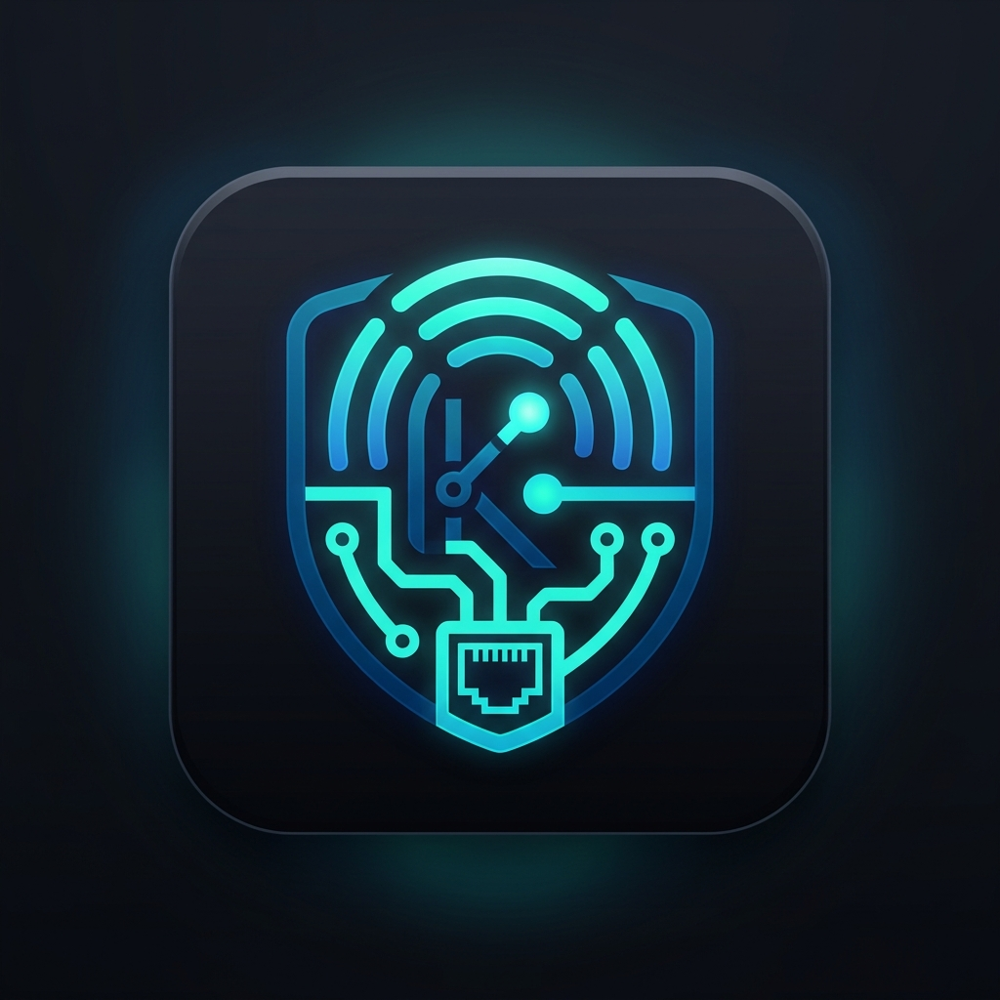

# KernelChip Laurent Integration for Home Assistant

<p align="center">
  
</p>

<p align="center">
  <b>Высокоскоростная асинхронная интеграция контроллеров KernelChip серии Laurent (Laurent-5, Laurent-5G, Laurent-4, Laurent-2, Laurent-128) в Home Assistant с поддержкой HACS.</b>
</p>

---

## ⚡ Особенности и архитектура

Интеграция использует **гибридную архитектуру связи**, специально адаптированную под аппаратные особенности контроллеров KernelChip:

1. **Постоянный TCP-сокет (порт 2424, Local Push):**
   - Мгновенная реакция (задержка < 10 мс) на аппаратные события: изменение дискретных входов, срабатывание реле, поднесение RFID/Wiegand карт.
   - Управление нагрузками: включение/выключение реле и выдача импульсов на электрозамки без очередей.
   - Защита сокета от переполнения: лёгкий протокол обмена и таймауты отправки, предотвращающие зависание сетевого стека Microchip.

2. **Непрерывный HTTP JSON API (`/json_sensor.cgi`):**
   - Фоновый опрос полной аппаратной телеметрии (счётчики импульсов, расходомеры, АЦП, температура 1-Wire, переменные).
   - Запрос с заголовком `Connection: close` предотвращает зависание встроенного однопоточного веб-сервера контроллера.
   - Данные обновляются непрерывно каждые `scan_interval` секунд (по умолчанию 5 с) независимо от статуса TCP-сессии.

---

## 📋 Поддерживаемые сущности и возможности

### 🔑 СКУД и считыватели Wiegand
- **Сенсоры считывателей (`sensor.laurent_wiegand_reader_1 ... N`):**
  - Состояние сущности отображает **номер последней отсканированной карты (UID)**.
  - Поддержка **байт-реверса (Little-Endian / Big-Endian)**: настраивается в параметрах интеграции (совместимо с веб-интерфейсом Laurent и JS-декодером `hexToUid`).
  - Атрибуты сенсора содержат: `raw_uid` (исходный код), `formatted_uid` (с учётом реверса), `reader` (номер считывателя), `last_scanned` (точное время считывания).
  - Дублирование событий в шину Home Assistant `laurent_wiegand_event` для автоматизаций.

### ⚡ Аналоговые входы АЦП (ADC 1 – ADC 5)
- **Каналы ADC 1 – ADC 5:** поддержка 5 каналов измерений на Laurent-5 (включая делитель напряжения на ADC 1 до 25 В и ИОН +2.5 В).
- **Настраиваемые единицы измерения:** в настройках интеграции можно задать любую физическую единицу для каждого канала (`ATM`, `bar`, `кПа`, `V`, `mV`, `%`, `°C`).
- **Сенсоры не заблокированы классом напряжения:** если к АЦП подключен датчик давления, введите `ATM` или `bar` — Home Assistant корректно применит единицу, а иконка автоматически изменится на манометр `mdi:gauge`.
- Учитывает пользовательские калибровочные коэффициенты, заданные в веб-интерфейсе Laurent.

### 🔢 Счётчики импульсов MPL (Meter Pulse Lines)
- **MPL IO 1 – 8:** аппаратные счётчики импульсов на линиях IO1–IO8.
- **MPL IN 1 – 6:** аппаратные счётчики на оптоизолированных входах IN1–IN6.
- Класс состояния `TOTAL_INCREASING`, единица измерения `pulses`.
- Подходят для приборов учёта ресурсов с импульсными выходами (счётчики воды, газа, электроэнергии).

### 💧 Расходомеры FLOW (FLM)
- **Flow Rate (мгновенный расход):** `sensor.laurent_flow_rate_io_X` и `flow_rate_in_X` (единица `L/min`, класс `MEASUREMENT`).
- **Flow Total (накопленный объём):** `sensor.laurent_flow_total_io_X` и `flow_total_in_X` (единица `L`, класс `TOTAL_INCREASING`, тип устройства `water`).
- Полная интеграция с разделом **«Энергия / Вода» (Home Assistant Energy Dashboard)**.

### 🌡 Температура 1-Wire (DS18B20)
- Сенсоры `Temperature 1 ... N` с автоопределением датчиков из таблицы `owi_temp`.
- Точное отображение температуры в °C, класс `TEMPERATURE`.

### 🔌 Реле и кнопки управления
- **Реле (`switch.laurent_relay_1 ... 4`):** статус реле с обратной связью. Строгое соответствие аппаратному числу механических реле (4 на Laurent-5, без фантомных выходов).
- **Кнопки импульса (`button.laurent_open_door_pulse_relay_1 ... 4`):** кратковременный импульс (1 секунда) для открывания электромагнитных/электромеханических замков, ворот и шлагбаумов.

### 🚪 Дискретные входы
- **Бинарные сенсоры (`binary_sensor.laurent_input_1 ... 6`):** оптоизолированные входы IN1–IN6 с мгновенной фиксацией изменения состояний через TCP-события `EIN`.
- Диагностический сенсор связи `binary_sensor.laurent_tcp_connection`.

### 🧩 Переменные и логика CAT
- **Пользовательские переменные (`sensor.laurent_variable_1 ... 10`):** чтение и установка значений внутренних регистров `VAR1-VAR10` (`~UV1~-~UV10~`).
- **Webhook для системы CAT ($KE,URL,RUN):** автоматический URL `/api/webhook/laurent_<entry_id>` для приёма параметров из реакций CAT.

---

## 📦 Установка

### Способ 1: Через HACS (Рекомендуемый)
1. Откройте **HACS** в Home Assistant -> меню в правом верхнем углу (три точки) -> **Пользовательские репозитории** (Custom repositories).
2. Вставьте URL данного репозитория, категория: **Интеграция** (Integration).
3. Нажмите **Добавить**, найдите в списке **KernelChip Laurent** и нажмите **Установить**.
4. Перезапустите Home Assistant.

### Способ 2: Вручную
1. Скопируйте папку `custom_components/laurent/` в папку `config/custom_components/laurent/` вашего Home Assistant.
2. Перезапустите Home Assistant.

---

## ⚙️ Первоначальная настройка

1. В Home Assistant перейдите в **Настройки** -> **Устройства и службы** -> **Добавить интеграцию**.
2. В поиске найдите **KernelChip Laurent** (или **Laurent**).
3. Укажите параметры подключения:
   - **IP-адрес:** сетевой адрес контроллера (например, `192.168.0.101`).
   - **TCP-порт:** порт управления (по умолчанию `2424`).
   - **Пароль:** пароль доступа к Ke-командам и веб-интерфейсу (по умолчанию `Laurent`).
   - **Интервал опроса:** частота фонового обновления аналоговых данных в секундах (по умолчанию `5`).
   - **Реверс байтов UID Wiegand:** `Включено` (рекомендуется для стандартных считывателей СКУД).
4. Нажмите **Отправить**. Интеграция определит модель (Laurent-5, Laurent-4 и др.), запросит прошивку и автоматически создаст все сущности.

---

## 🎛 Настройка единиц измерения АЦП (ATM, bar, кПа, %)

Если к каналам АЦП подключены датчики давления, уровня, влажности или другие аналоговые сенсоры:
1. Перейдите в **Настройки** -> **Устройства и службы** -> **Laurent**.
2. Нажмите кнопку **«Настроить»** (Configure).
3. В открывшемся окне введите желаемую единицу измерения для каждого канала:
   - `adc_1_unit`: например, `V` (или оставить по умолчанию)
   - `adc_2_unit`: например, `ATM` (давление в атмосферах)
   - `adc_3_unit`: например, `bar`
   - `adc_4_unit`: например, `кПа`
   - `adc_5_unit`: например, `%`
4. Нажмите **Отправить**. Интеграция перезагрузится, и сенсоры АЦП сразу отобразят заданные единицы с адаптированными иконками (манометр для давления).

---

## 💡 Примеры автоматизаций

### 1. Открытие двери по Wiegand-карте
```yaml
alias: "СКУД: Открытие замка по карте"
trigger:
  - platform: state
    entity_id: sensor.laurent_wiegand_reader_1
condition:
  # Проверка белого списка карт
  - condition: template
    value_template: >
      {{ trigger.to_state.state in ['04A1B2C3', '78BF529E'] }}
action:
  # Импульс на реле замка (1 секунда)
  - service: button.press
    target:
      entity_id: button.laurent_open_door_pulse_relay_1
  - service: logbook.log
    data:
      name: "СКУД"
      message: "Дверь открыта по карте: {{ trigger.to_state.state }}"
```

### 2. Оповещение об утечке / превышении расхода воды
```yaml
alias: "Контроль расхода воды"
trigger:
  - platform: numeric_state
    entity_id: sensor.laurent_flow_rate_io_7
    above: 15.0 # Расход более 15 л/мин
    for:
      minutes: 10
action:
  - service: notify.persistent_notification
    data:
      title: "Внимание: Высокий расход воды!"
      message: "Расход воды на линии IO7 превышает 15 л/мин более 10 минут."
```

### 3. Автоматика по давлению (сенсор АЦП в ATM)
```yaml
alias: "Защита насоса по низкому давлению"
trigger:
  - platform: numeric_state
    entity_id: sensor.laurent_adc_2
    below: 1.5 # Давление ниже 1.5 ATM
action:
  - service: switch.turn_off
    target:
      entity_id: switch.laurent_relay_2
  - service: notify.notify
    data:
      message: "Насос выключен: давление упало до {{ states('sensor.laurent_adc_2') }} ATM."
```

### 4. Приём вебхуков от логики CAT ($KE,URL,RUN)
```yaml
alias: "Событие CAT Laurent"
trigger:
  - platform: event
    event_type: laurent_cat_push
action:
  - service: logbook.log
    data:
      name: "Laurent CAT"
      message: "Получены данные CAT: {{ trigger.event.data }}"
```

---

## 🛠 Поддерживаемые модели

| Модель | Реле | Входы | АЦП | Wiegand | Импульсы / Расход | 1-Wire |
| :--- | :---: | :---: | :---: | :---: | :---: | :---: |
| **Laurent-5 / 5G** | 4 | 6 | 5 (до 25В) | 1 считыватель | MPL IO 1-8 / IN 1-6, FLOW | Да (OWI) |
| **Laurent-4** | 4 | 4 | 4 | 4 считывателя | MPL IO 1-8, FLOW | Да |
| **Laurent-2** | 2 | 2 | 2 | 1 считыватель | MPL | Да |
| **Laurent-128 / 112**| 28 / 12 | до 128 | Да | Да | MPL, FLOW | Да |

---

## 📄 Лицензия
Проект распространяется под лицензией [MIT](LICENSE).
Разработано для сообщества Home Assistant.
